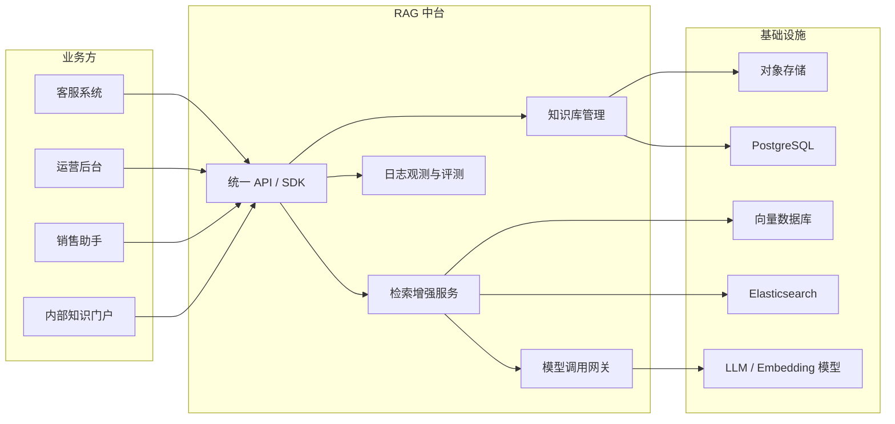
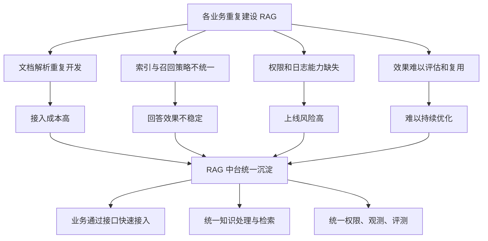
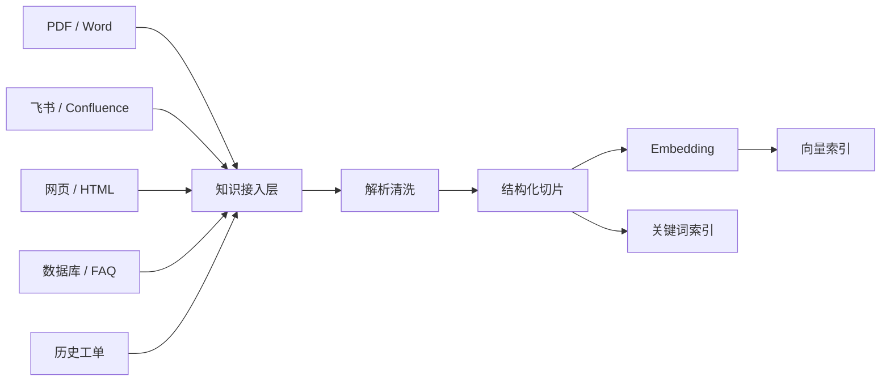
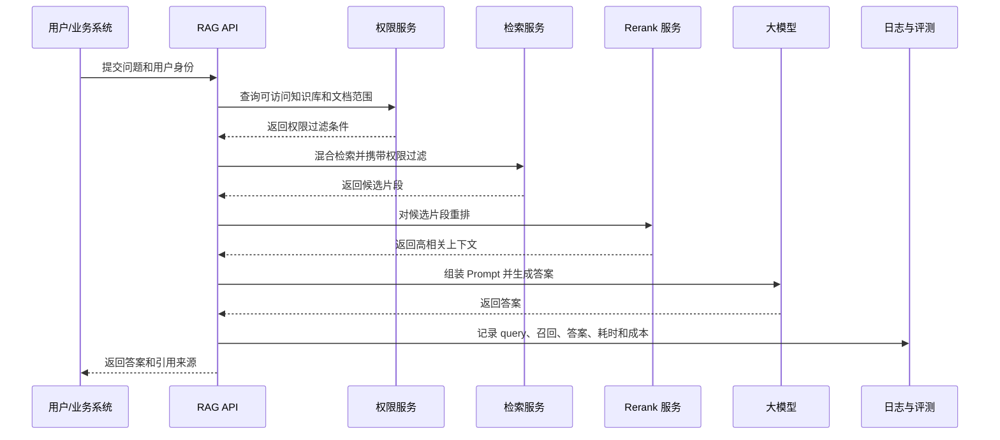
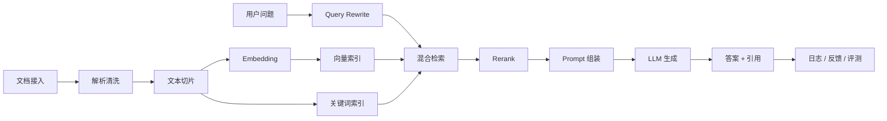

# RAG 中台项目意义

## 项目定位

这个项目不是一个简单的聊天机器人 Demo，而是一个面向业务系统的 RAG 能力中台。

它的核心目标是：把知识接入、文档解析、索引构建、检索增强、模型调用、权限控制、日志观测和效果评测等通用能力沉淀成平台服务，让业务方可以通过统一接口快速接入 RAG 能力。

业务方不需要关心 embedding、向量数据库、chunk 策略、rerank、prompt 组装、模型切换等底层细节，只需要创建知识库、上传或同步文档，然后调用问答接口即可。



## 为什么做这个项目

现在很多团队都有类似需求：

- 客服团队希望基于产品文档、FAQ、工单记录做智能问答。
- 运营团队希望新人可以快速查询 SOP、活动规则和历史方案。
- 销售团队希望基于产品资料快速生成客户回复或方案。
- 内部员工希望更高效地搜索制度、流程和技术文档。
- 业务系统希望在自己的页面中嵌入一个知识助手。

如果每个业务方都各自实现一套 RAG，就会重复处理很多共性问题：文档解析、文本切片、向量化、索引更新、权限隔离、Prompt 调优、召回优化、模型成本控制、日志追踪和效果评测。

这些问题如果没有统一平台承接，很容易导致每个业务都只做出一个短期可演示的 Demo，但很难稳定上线、持续优化和规模化复用。

因此，建设 RAG 中台的意义在于：把 RAG 从单点应用升级为企业可复用的 AI 基础设施，降低业务系统接入大模型能力的成本。



## 解决的实际问题

### 1. 解决知识分散、难以被大模型使用的问题

企业内部知识通常分散在 PDF、Word、飞书文档、Confluence、网页、数据库、客服系统和历史工单中。

RAG 中台可以统一接入这些知识源，对文档进行解析、清洗、切片、向量化和索引构建，将原本分散的内容转化为模型可以检索和引用的知识资产。



### 2. 解决业务接入成本高的问题

业务方不需要理解 RAG 的底层实现，也不需要自己维护向量库、Embedding 模型、检索策略和 Prompt 模板。

中台可以提供统一接口，例如：

```http
POST /chat
POST /knowledge-bases/{id}/documents
```

业务系统只需要传入应用 ID、知识库 ID、用户问题等参数，就可以接入问答能力。这样可以把原本需要数周完成的接入工作压缩到几天甚至更短。

### 3. 解决答案不可控、不可追溯的问题

直接调用大模型容易出现幻觉，且回答依据不透明。

RAG 中台可以在回答时返回引用来源、命中文档片段、相似度分数和原始文档信息，让答案具备可解释性和可审计性。

示例：

```json
{
  "answer": "退款需要在订单完成后 7 天内申请。",
  "citations": [
    {
      "title": "退款政策",
      "chunk_id": "chunk_123"
    }
  ]
}
```

### 4. 解决效果无法持续优化的问题

很多 RAG 项目上线后，很难判断回答是否准确、召回是否合理、用户是否满意。

RAG 中台可以记录 query、召回片段、生成答案、用户反馈、耗时、token 消耗和模型调用日志，并支持评测集、人工反馈和 A/B 测试。

这样可以持续优化 chunk 策略、召回策略、rerank 模型、Prompt 模板和模型选择。

### 5. 解决企业级权限和多租户问题

真实业务场景中，不是所有用户都能访问所有知识。

RAG 中台需要在检索阶段前置权限过滤，例如基于 `tenant_id`、`department_id`、`user_role`、`knowledge_base_id`、`document_acl` 等字段控制文档可见范围，避免模型基于用户无权限访问的内容生成回答。



## 对面试的帮助

### 1. 展示 AI 应用落地能力

这个项目可以完整体现 RAG 的工程链路：

文档接入 -> 解析清洗 -> 文本切片 -> embedding -> 向量索引 -> 混合检索 -> rerank -> Prompt 组装 -> LLM 生成 -> 引用返回 -> 日志评测。



相比只调用一个大模型 API，这个项目更能说明你理解 AI 应用从 Demo 到生产可用之间需要补齐的工程能力。

### 2. 展示后端架构能力

RAG 中台天然涉及很多后端系统设计问题，包括：

- 多租户隔离
- 异步任务处理
- 文档处理状态流转
- 索引增量更新
- 模型服务抽象
- 缓存与限流
- 日志追踪
- 监控告警
- 配置化策略

这些都是后端面试中非常容易展开追问的点。

### 3. 展示中台化和平台化思维

这个项目不只是完成一个业务功能，而是把多个业务都会用到的 RAG 能力抽象成统一平台。

可以在面试中强调：

> 我把 RAG 拆成知识管理、检索服务、生成服务、模型网关、评测观测几个模块。业务方通过 app_id 和 kb_id 接入，不需要重复建设底层能力。

这能体现你具备从单业务实现走向平台能力建设的思考。

### 4. 展示真实问题意识

面试中可以主动讨论一些真实落地难点：

- PDF 解析质量不稳定。
- chunk 太大召回不准，chunk 太小上下文容易断裂。
- 向量召回对关键词、编号、专有名词不够敏感。
- RAG 可能召回相似但错误的文档。
- LLM 可能不严格基于上下文回答。
- 权限过滤必须在检索阶段前置。
- 文档更新后索引需要支持增删改和失败重试。
- 成本和延迟需要持续控制。

这些内容可以让面试官感受到你不是只看过教程，而是理解 RAG 工程化落地中的实际问题。

### 5. 适合作为 STAR 项目叙述

这个项目很适合在面试中按照 STAR 方式表达：

> 背景是多个业务系统都有知识问答需求，但每个系统单独接大模型成本高、效果不稳定，也缺少统一评测。因此我设计了一个 RAG 中台，把知识接入、索引构建、检索增强、模型调用、权限控制和效果观测统一封装。业务方只需要创建知识库、上传文档并调用问答接口，就可以快速接入 RAG 能力。

后续可以继续展开具体技术实现、架构设计、核心难点和优化结果。

## 一句话总结

RAG 中台的意义是：把 RAG 从单个聊天 Demo 升级成企业可复用的 AI 基础设施，解决业务系统接入大模型时的知识接入、检索质量、权限安全、可观测和持续优化问题。

对面试而言，它既能体现你跟上 AI 应用趋势，又能展示扎实的后端架构、中台设计和工程落地能力。
