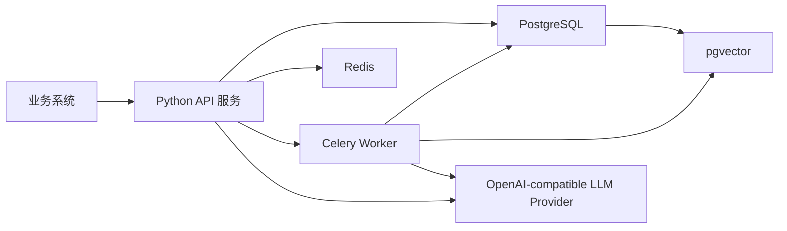
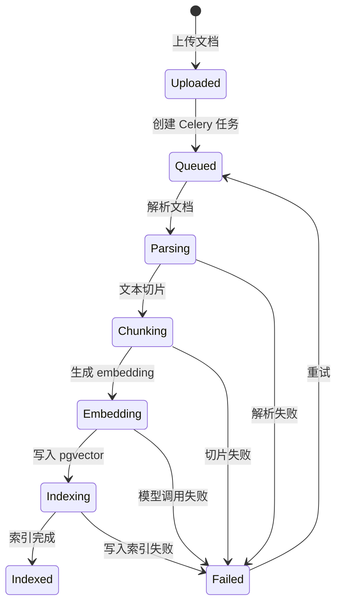

# RAG 中台技术栈选型

## 总体选型

本项目定位是面向业务系统复用的 RAG 能力中台，核心目标是稳定承接知识接入、文档处理、索引构建、检索增强、模型调用、权限控制、日志观测和效果评测。

技术栈建议：

- Python 3.11
- PostgreSQL + pgvector
- Redis
- Celery
- OpenAI-compatible LLM Provider

说明：如果前面提到的 `Python 1.1` 是笔误，这里按实际项目中更合理的 `Python 3.11` 进行选型。



## 1. Python 3.11

### 用在哪里

Python 作为项目的主要后端开发语言，用于实现：

- RAG API 服务
- 知识库管理接口
- 文档上传与解析逻辑
- 文本切片、清洗和元数据处理
- embedding 调用
- 检索编排逻辑
- Prompt 组装
- LLM 调用
- 评测脚本和离线分析任务

如果项目使用 Web 框架，可以选择 FastAPI 来承接 HTTP API，例如：

```http
POST /knowledge-bases
POST /documents/upload
POST /rag/retrieve
```

### 为什么适合

Python 非常适合 RAG 和 AI 应用开发，原因是生态完整、开发效率高、模型相关 SDK 支持好。

它在这个项目中的优势主要有：

- AI 生态成熟：LangChain、LlamaIndex、OpenAI SDK、transformers、sentence-transformers 等工具都优先支持 Python。
- 文档处理方便：PDF、Word、HTML、Markdown、OCR 等解析库丰富。
- 异步任务生态完善：Celery、Redis、RQ 等组件使用成熟。
- 开发效率高：适合快速实现 RAG 链路，并持续迭代检索策略和 Prompt。
- 便于评测分析：可以用 Python 快速做召回率、命中率、上下文相关性等离线分析。

面试表达：

> Python 适合这个项目，是因为 RAG 涉及大量模型调用、文档解析和实验性策略优化。Python 的 AI 生态和数据处理生态更成熟，可以让我更快地完成从文档处理到检索生成再到评测分析的完整闭环。

## 2. PostgreSQL + pgvector

### 用在哪里

PostgreSQL 用作核心业务数据库，保存中台的结构化数据，例如：

- 用户、租户、业务应用
- 知识库信息
- 文档元数据
- chunk 元数据
- 文档处理状态
- 会话记录
- 调用日志
- 用户反馈
- 评测集和评测结果

pgvector 用于在 PostgreSQL 中存储和检索向量数据，例如：

- chunk embedding
- query embedding
- 向量相似度检索
- 基于 `tenant_id`、`kb_id`、`document_acl` 的过滤检索

一个 chunk 可以同时保存结构化元数据和向量：

```text
chunk_id
doc_id
kb_id
tenant_id
content
metadata
embedding vector
created_at
updated_at
```

### 为什么适合

PostgreSQL + pgvector 非常适合 MVP 和中小规模 RAG 中台，主要原因是简单、稳定、易运维。

相比一开始就引入独立向量数据库，它有几个优势：

- 架构简单：业务数据和向量数据可以放在同一个数据库中。
- 事务一致性好：文档、chunk、embedding、处理状态可以统一管理。
- 运维成本低：不需要额外维护 Milvus、Qdrant 等独立服务。
- 过滤检索方便：可以结合 SQL 条件做租户、知识库、权限过滤。
- 适合面试项目落地：既能体现向量检索能力，又不会把系统复杂度拉得过高。

面试表达：

> 第一版我会选 PostgreSQL + pgvector，因为它能同时承接业务数据和向量检索，架构简单，事务一致性好，也方便做权限过滤。等数据规模和检索性能要求上来后，再通过 VectorStore 接口切换到 Milvus 或 Qdrant。

## 3. Redis

### 用在哪里

Redis 在项目中主要承担缓存、任务中间件和临时状态存储。

典型使用场景：

- Celery broker：作为异步任务队列的消息中间件。
- 热点缓存：缓存知识库配置、应用配置、模型配置。
- 会话缓存：保存短期对话上下文或 streaming 状态。
- 限流计数：按租户、应用、用户进行接口调用限流。
- 幂等控制：防止文档重复上传、重复创建索引任务。
- 分布式锁：避免同一文档被多个 worker 重复处理。

例如文档上传后，可以把处理任务投递到 Redis 队列：

```text
document_uploaded -> Redis broker -> Celery worker -> parse/chunk/embed/index
```

### 为什么适合

Redis 的优势是快、轻量、生态成熟，适合处理 RAG 中台里的高频临时数据。

它适合这个项目的原因：

- 与 Celery 集成成熟，适合作为 broker。
- 读写性能高，适合缓存配置和短期会话状态。
- 支持 TTL，适合保存临时任务状态、限流计数和幂等 key。
- 支持简单分布式锁，方便控制文档处理并发。
- 部署简单，适合 MVP 和面试项目快速落地。

面试表达：

> Redis 在这里不是主存储，而是承担高频临时状态和异步任务中间件。比如文档处理任务通过 Redis 投递给 Celery，知识库配置和模型配置可以缓存到 Redis，接口限流和幂等控制也可以用 Redis 实现。

## 4. Celery

### 用在哪里

Celery 用于处理 RAG 中台中的异步耗时任务。

文档处理链路通常比较长，不适合同步阻塞在 HTTP 请求中完成。典型异步任务包括：

- 文档解析
- 文本清洗
- chunk 切片
- embedding 生成
- 写入 pgvector
- 删除文档后的索引清理
- 文档重新索引
- 批量导入知识库
- 离线评测任务

文档处理流程可以设计为：



### 为什么适合

Celery 是 Python 生态中成熟的分布式任务队列，适合处理 RAG 系统里的长耗时、可重试、可扩展任务。

它的优势包括：

- 支持异步处理，避免文档上传接口长时间阻塞。
- 支持失败重试，适合处理模型调用失败、网络抖动、解析异常等问题。
- 支持任务状态追踪，方便前端展示 processing、indexed、failed 等状态。
- 支持横向扩展 worker，提高批量文档处理能力。
- 与 Redis、Python 生态集成成熟。

面试表达：

> 文档处理、embedding 和索引写入都可能比较耗时，也可能失败，所以我会用 Celery 做异步任务。API 层只负责接收文档和创建任务，真正的解析、切片、向量化和索引写入由 worker 执行，并通过状态字段暴露处理进度。

## 5. OpenAI-compatible LLM Provider

### 用在哪里

OpenAI-compatible LLM Provider 用于统一封装模型调用。第一阶段主要使用 embedding 模型生成向量，chat 模型能力可以作为后续扩展或业务方侧能力预留。

它可以用于：

- 调用 embedding 接口生成向量
- 后续扩展时调用 chat completion
- 后续扩展时支持流式输出
- 统一管理模型参数
- 统计 token 用量和调用耗时
- 切换不同模型供应商

在 RAG 链路中，它主要出现在两个阶段：

```text
文档入库阶段：chunk text -> embedding model -> vector
检索阶段：query text -> embedding model -> query vector
```

### 为什么适合

选择 OpenAI-compatible 接口，不一定代表只能使用 OpenAI，而是使用一套兼容 OpenAI API 格式的模型调用规范。

这样可以接入多种模型服务：

- OpenAI
- Azure OpenAI
- DeepSeek
- 通义千问
- 智谱
- 本地 vLLM / Ollama / LM Studio
- 公司内部模型网关

优势是：

- 接口统一：降低不同模型厂商之间的适配成本。
- 方便切换模型：可以按成本、效果、延迟选择模型。
- 方便做模型网关：统一超时、重试、限流、日志和 token 统计。
- 适合国产模型或私有化部署：只要兼容 OpenAI 协议，上层代码基本不用改。
- 降低供应商绑定风险：避免项目强依赖单一模型厂商。

面试表达：

> 我不会把代码写死在某个模型厂商上，而是通过 OpenAI-compatible Provider 做统一封装。这样无论底层是 OpenAI、DeepSeek、通义，还是本地 vLLM 服务，上层 RAG 编排逻辑都可以保持一致。

## 技术栈在 RAG 链路中的位置

```mermaid
flowchart TB
    A["业务方调用 /rag/retrieve"] --> B["Python API 服务"]
    B --> C["读取知识库和应用配置"]
    C --> D["PostgreSQL"]
    C --> E["Redis 缓存"]
    B --> F["生成 query embedding"]
    F --> G["OpenAI-compatible Provider"]
    B --> H["pgvector 向量检索"]
    H --> D
    B --> I["组装 RAG 上下文"]
    I --> K["返回上下文片段、引用、分数"]
    K --> L["写入检索日志和反馈数据"]
    L --> D

    M["上传文档"] --> N["Python API 服务"]
    N --> O["创建文档记录"]
    O --> D
    N --> P["投递 Celery 任务"]
    P --> Q["Redis Broker"]
    Q --> R["Celery Worker"]
    R --> S["解析 / 切片 / Embedding / 索引"]
    S --> D
```



## 为什么这个组合适合面试项目

这套技术栈的特点是：简单、稳定、能跑通完整工程链路，同时保留后续扩展空间。

- Python 3.11：适合 AI 应用开发，生态成熟，开发效率高。
- PostgreSQL + pgvector：同时承接业务数据和向量检索，降低早期系统复杂度。
- Redis：支持缓存、限流、幂等、分布式锁和 Celery broker。
- Celery：承接文档解析、embedding、索引构建等异步任务。
- OpenAI-compatible Provider：屏蔽模型厂商差异，方便切换模型和做模型网关。

面试中可以总结为：

> 第一版我选择 Python 3.11 + PostgreSQL/pgvector + Redis + Celery + OpenAI-compatible Provider，是为了用相对轻量的架构跑通完整 RAG 中台闭环。它既能支撑知识接入、异步索引、向量检索、RAG 上下文返回和日志评测，也保留了后续替换向量库、扩展模型供应商、横向扩展 worker 的空间。
