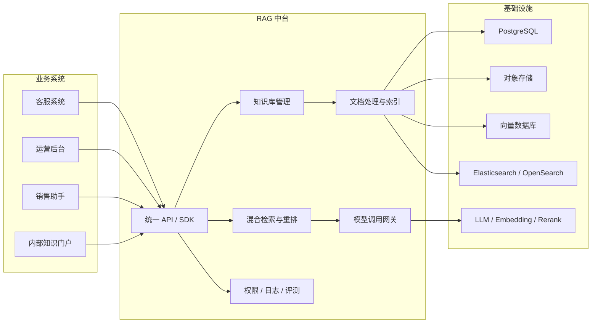
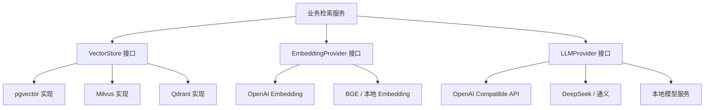
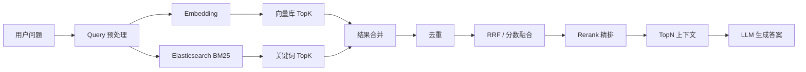
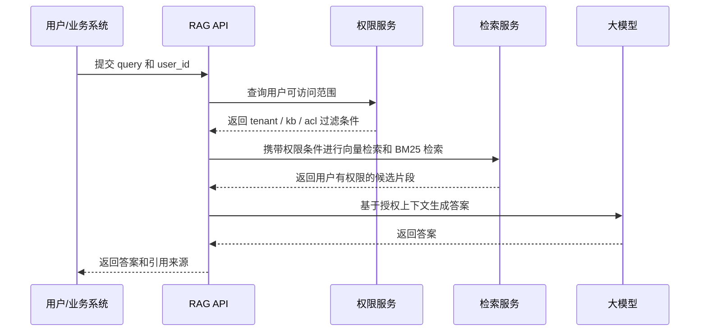
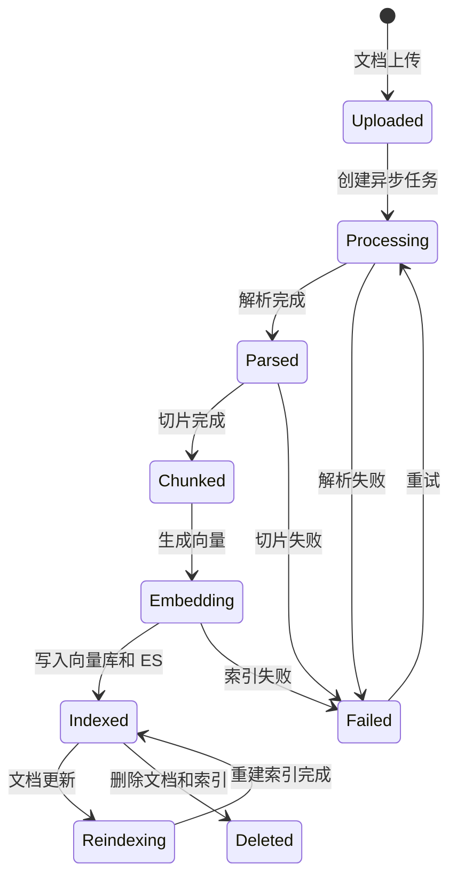
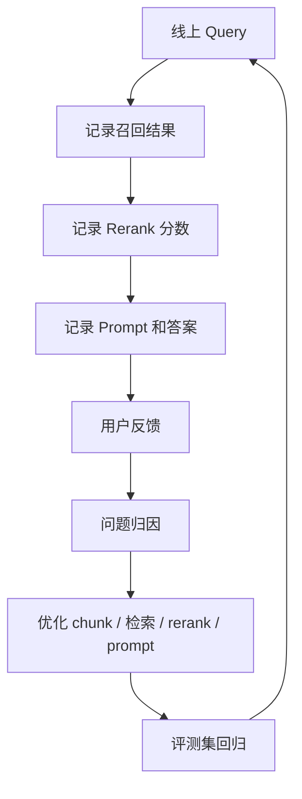

# RAG 中台面试 6 大核心亮点

## 总体概括

这个项目不是一个单业务的 RAG Demo，而是一个面向多个业务系统复用的 RAG 能力中台。

它把知识接入、文档处理、索引构建、混合检索、模型调用、权限控制、日志观测和效果评测沉淀为统一平台能力。业务方只需要通过 API/SDK 接入，就可以快速获得知识问答、文档助手、客服助手、内部搜索等能力。



## 亮点 1：平台化设计，从 RAG Demo 升级为 RAG 中台

很多 RAG 项目只是围绕一个业务场景写死的问答机器人，这个项目的重点是把 RAG 拆成可复用的平台能力。

中台统一承接：

- 知识库创建与管理
- 文档上传、解析、切片和索引
- 检索、重排和生成
- 模型配置和 Prompt 模板
- 多业务接入、日志记录和效果评测

业务方不需要重复建设底层 RAG 链路，只需要传入 `app_id`、`kb_id`、`user_id` 和 `query` 调用接口。

面试表达：

> 我不是把 RAG 写死在某个业务里，而是把它设计成中台服务。业务方通过统一 API 接入，底层的知识处理、索引构建、检索增强、模型调用、权限和观测都由中台统一承接。

## 亮点 2：可插拔架构，不绑定单一向量库或模型

中台不直接依赖某一个具体向量库、Embedding 模型或大模型，而是抽象统一接口，让底层能力可以替换。

核心抽象包括：

- `VectorStore`：屏蔽 pgvector、Milvus、Qdrant 等差异
- `EmbeddingProvider`：屏蔽不同 embedding 模型差异
- `LLMProvider`：屏蔽 OpenAI、DeepSeek、通义、本地模型等差异
- `Reranker`：屏蔽不同重排模型实现
- `DocumentParser`：屏蔽 PDF、Word、HTML、Markdown 等解析差异



面试表达：

> 我希望这个系统不是一次性 Demo，所以核心能力都做了接口抽象。比如向量库只依赖 VectorStore 接口，上层检索逻辑不关心底层是 pgvector、Milvus 还是 Qdrant。后续可以根据成本、性能、部署环境替换实现。

## 亮点 3：混合检索，不只依赖向量召回

真实业务查询既有语义问题，也有精确匹配问题。单纯向量检索容易漏掉编号、错误码、接口名、产品型号、条款号等精确内容；单纯关键词检索又不擅长同义表达和口语化问题。

所以项目设计了混合检索：

- 向量检索：负责语义相似召回
- BM25 检索：通过 Elasticsearch / OpenSearch 负责关键词召回
- RRF 或加权融合：合并两路结果
- Rerank：对候选片段进行精排
- TopN 上下文：组装进 Prompt，交给大模型生成答案



例如用户问：

```text
VBC-REFUND-007 这个退款规则是什么？
```

向量检索会召回“退款规则、售后政策”相关片段，BM25 会优先命中包含 `VBC-REFUND-007` 的片段。两边结果合并后，如果某个 chunk 同时语义相关又命中编号，它会在融合和重排后排到更靠前。

面试表达：

> 我没有只做 embedding + topK，因为企业文档里有很多编号、错误码、接口名和专有名词。我的设计是向量库负责语义召回，Elasticsearch / OpenSearch 的 BM25 负责关键词召回，然后用 RRF 做融合，再通过 rerank 精排，兼顾语义泛化和精确匹配。

## 亮点 4：企业级权限与多租户隔离

RAG 不只是要回答正确，还要保证“该不该回答”。

真实企业场景中，不同租户、部门、角色、业务系统能访问的知识范围不同。如果无权限文档进入上下文，即使最终不展示原文，也可能被模型吸收到回答里，产生数据泄露风险。

因此权限过滤要前置到检索阶段，而不是生成后再做文本过滤。

可以在文档和 chunk 上维护元数据：

- `tenant_id`
- `app_id`
- `knowledge_base_id`
- `department_id`
- `user_role`
- `document_acl`



面试表达：

> RAG 的权限控制不能只放在接口层，必须前置到检索阶段。用户没有权限的文档不应该进入候选上下文，否则模型可能基于这些内容生成回答。

## 亮点 5：异步文档处理与索引生命周期管理

文档处理链路比较长，通常包含上传、解析、切片、embedding、写入向量库、写入 ES、状态更新等步骤。PDF 解析、embedding 调用、索引写入都可能失败，所以不适合同步阻塞处理。

项目可以设计成异步任务流：



重点能力包括：

- 文档处理状态流转
- 异步任务队列
- 失败重试
- 增量更新
- 删除文档时清理 chunk、向量和 ES 索引
- 重新索引
- 处理日志追踪

面试表达：

> 文档上传后我不会同步阻塞处理，而是创建异步任务。文档有 processing、indexed、failed 等状态，方便业务方查询处理进度，也方便失败后重试和排查问题。

## 亮点 6：可观测与评测闭环，支持持续优化效果

RAG 不是上线后就结束，效果需要持续评估和优化。一次回答不好，可能是没召回、召回错了、rerank 不准、Prompt 不合适，也可能是模型生成阶段没有严格基于上下文。

所以项目需要记录完整链路数据：

- 用户 query
- 命中的 chunk
- 向量分数、BM25 分数、rerank 分数
- Prompt 和模型回答
- 引用来源
- 响应耗时
- token 成本
- 用户点赞、点踩、纠错反馈
- 评测集命中率和答案质量



面试表达：

> RAG 效果不是一次性调出来的，所以我设计了日志、反馈和评测闭环。通过记录每次 query 的召回结果、生成答案、耗时、成本和用户反馈，可以定位问题到底发生在召回、重排、Prompt 还是生成阶段。

## 面试总述

这个项目的核心亮点可以总结为：

> 平台化接入、可插拔组件、混合检索、权限隔离、异步索引生命周期管理，以及可观测评测闭环。

它体现的不是单点 RAG Demo，而是企业级 AI 应用基础设施的设计能力。
